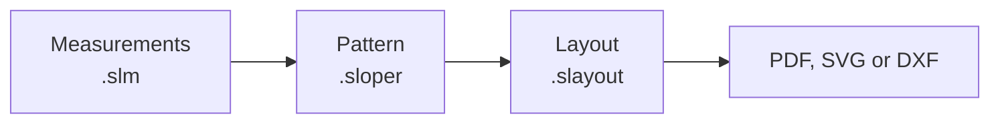

# The apps and their files

Each app works on its own kind of file, and the files point to one another:

| File | Made by | Holds |
| --- | --- | --- |
| Measurements `.slm` | opensloper-measurements | One person's measurements, or a size table with a value for each size |
| Pattern `.sloper` | opensloper-design | The formulas that place every point and line, and the pieces, seams, markings and notes |
| Layout `.slayout` | opensloper-publish | Where each piece goes on the pages or roll, for one or more patterns |

## Measurements

A measurement file holds values by key, such as `waist` or `hip`. Values are
always stored in millimetres; the measurements app shows them in the unit you
choose. A pattern names the measurement file it uses, and you can swap in
another person's file or another size to redraw the pattern for them.

## Patterns

A pattern stores only its definitions: the formula for each point and line, and
which edges make each piece. The positions are worked out again every time it
opens, so a pattern always fits the measurements it is given. Each pattern has
its own unit, mm, cm or inches, and the numbers in its formulas are in it.

## Layouts

A layout places the pieces of one or more patterns on printed pages, a plotter
roll or a cutting machine's bed. It reads the patterns when it opens, so a
change to a pattern shows in its layouts.

## Inside the files

The files are JSON text, so scripts and other programs can read and write them.
[File formats](../reference/files.md) lists every member of each file, with a
JSON Schema to check a file against.
