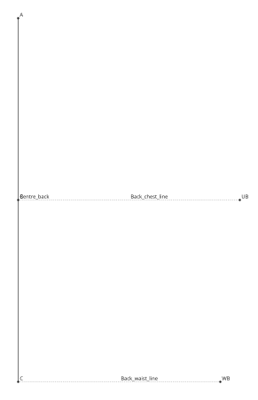
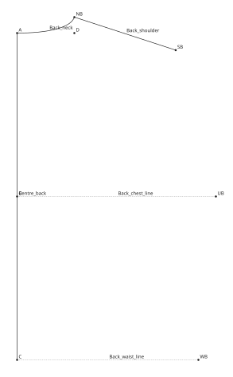
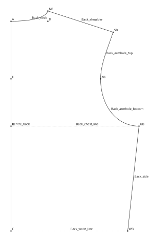
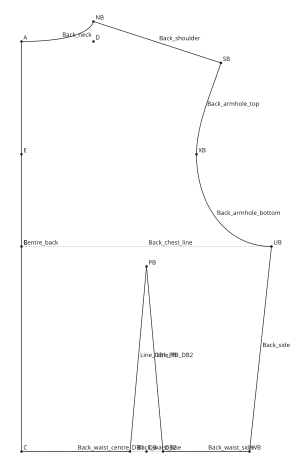
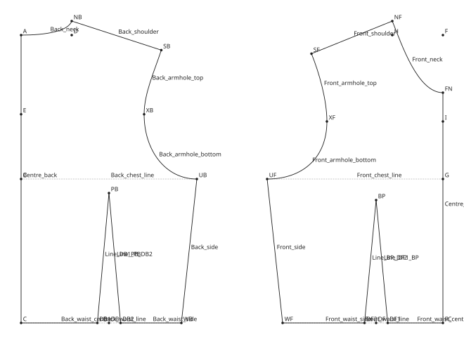
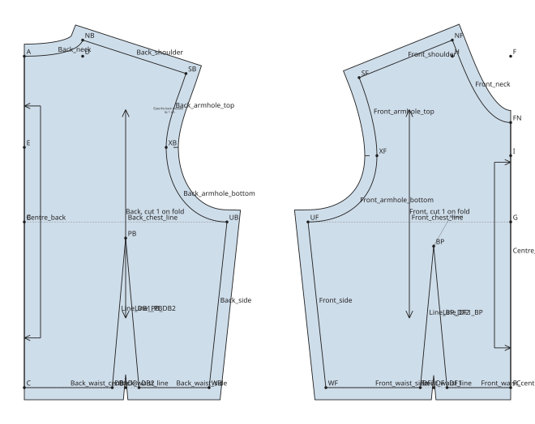

# A bodice block

This tutorial drafts a close-fitting bodice block from eight measurements: half
the back and half the front, each with a waist dart, cut on the fold. It builds
on the [straight skirt block](skirt-block.md), so do that one first. New here
are points placed at an angle, curves that read the angle of a line, armholes
made of two curves, seams checked for length, and notes.

The finished pattern is in the documentation's examples:
[bodice-block.sloper](../examples/bodice-block/bodice-block.sloper), with its
measurements in [bodice.slm](../examples/bodice-block/bodice.slm). Open it at
any point to compare.

!!! note "A block to learn from"

    The draft is simplified, so that each step shows one idea. It is a starting
    point for learning, not a tested fit: make a toile before cutting good
    cloth.

!!! note "Units"

    This tutorial works in centimetres. Before you start, set Edit →
    Preferences → Unit to Centimetres, so the new pattern is in cm. The
    measurement file is in millimetres, as all measurement files are; the
    pattern reads its values in centimetres.

## 1. Measurements and variables

Save [bodice.slm](../examples/bodice-block/bodice.slm) in a folder of its own.
Its measurements use the names in the measurement catalogue:

| Key | Value (mm) | What it is |
| --- | --- | --- |
| `bust_circumference` | 920 | Round the fullest part of the bust |
| `waist_circumference` | 740 | Round the natural waist |
| `neck_circumference` | 370 | Round the base of the neck |
| `shoulder_length` | 124 | Neck point to shoulder point |
| `across_back` | 350 | Across the back between the arm creases |
| `across_chest` | 330 | Across the chest between the arm creases |
| `bust_point_separation` | 190 | Between the bust points |
| `neck_back_to_waist` | 410 | Back neck to waist, at the centre back |

Start a new pattern (File → New), choose the measurement file (File →
Measurements → Open Set…) and save the pattern beside it as
`bodice-block.sloper`. Then add these variables in the Variables tab, as in the
skirt tutorial:

| Name | Formula | What it is |
| --- | --- | --- |
| `bust_ease` | `8` | Ease added round the bust |
| `waist_ease` | `4` | Ease added round the waist |
| `half_width` | `@bust_circumference / 4 + #bust_ease / 4` | Width of each half piece at the bust |
| `scye_depth` | `@bust_circumference / 8 + 9` | From the back neck down to the underarm |
| `neck_width` | `@neck_circumference / 5 - 0.2` | From the centre to the neck point |
| `shaping` | `#half_width - (@waist_circumference / 4 + #waist_ease / 4)` | Taken out at the waist on each half |
| `side_shaping` | `#shaping * 0.4` | Taken in at each side seam |
| `dart` | `#shaping * 0.6` | Width of each waist dart |
| `shoulder_ease` | `1` | How much longer the back shoulder is than the front |

Each half piece is a quarter of the bust with its ease. At the waist it is
narrower by `shaping`: 40% of that goes at the side seam and 60% in the dart.

## 2. The back frame

The back is drafted with the centre back on the left, from the back neck at the
top to the waist at the bottom.

1. With the Point tool (++p++), make **A** and set X and Y to `0`: the centre
   back neck.
2. Click straight below A for **B**, Length `#scye_depth`: the centre back at
   the level of the underarm. Click further below for **C**, Length
   `@neck_back_to_waist`: the centre back waist.
3. Click level with B, to its right, for **UB**, Length `#half_width`: the
   underarm at the side seam. Click right of C for **WB**, Length
   `#half_width - #side_shaping`: the waist at the side seam.

Then draw, with the Line tool (++l++):

| Line | From | To | Role |
| --- | --- | --- | --- |
| Centre_back | A | C | Outline |
| Back_chest_line | B | UB | Construction |
| Back_waist_line | C | WB | Construction |

## 3. The back neck and shoulder

The neck point is the neck's width from centre back and a little above A.

1. Click right of A for **D**, Length `#neck_width`, then straight above D for
   **NB**, Length `2`. D is only a step on the way: points need no line.
2. Click right of NB for **SB**, the shoulder point. Set its Length to
   `@shoulder_length + #shoulder_ease` and its Angle to `342`. Angles count
   anticlockwise from pointing right, so 342 is 18° below level: the slope of
   the shoulder.
3. Draw the line **Back_shoulder** from NB to SB.

The back neck curves from A, level at first, up to NB, and should meet the
shoulder square, at a right angle. Rather than work that angle out, let the
curve read it from the shoulder. Draw the curve **Back_neck** from A to NB with
the Curve tool (++c++), and set:

| Start angle | Start handle | End angle | End handle |
| --- | --- | --- | --- |
| `0` | `#neck_width / 2` | `Back_shoulder.angle + 270` | `1.5` |

`Back_shoulder.angle` is the shoulder line's direction, from NB to SB. The end
angle points back along the curve, so it is a quarter turn from the shoulder,
down into the neck. Change the shoulder's angle and the neck follows.

## 4. The back armhole

The armhole runs from the shoulder point, in past the across-back point, and
round to the underarm. It is drawn as two curves that meet at the across-back
point, going straight down there, so the join is smooth.

1. Click on Centre_back, nearer A, for **E**, and set its Distance or ratio to
   `#scye_depth * 0.55`: the level of the across-back measurement.
2. Click level with E, to its right, for **XB**, Length `@across_back / 2`.
3. Draw two curves, and the side seam:

| Curve | From | To | Start angle | Start handle | End angle | End handle |
| --- | --- | --- | --- | --- | --- | --- |
| Back_armhole_top | SB | XB | `Back_shoulder.angle - 90` | `3` | `90` | `3` |
| Back_armhole_bottom | XB | UB | `270` | `#scye_depth / 4` | `180` | `(#half_width - @across_back / 2) * 0.6` |

| Line | From | To | Role |
| --- | --- | --- | --- |
| Back_side | UB | WB | Outline |

The top curve leaves the shoulder square to it and arrives at XB going straight
down (its end angle, 90, points back up). The bottom curve leaves XB straight
down (270) and arrives at UB going level, so the armhole turns smoothly into
the side seam.

## 5. The back dart

The dart is centred on the back waist, its point 2 cm below the chest line.
Make three points on Back_waist_line, each by clicking on the line nearer C and
typing its Distance or ratio, so all are measured from centre back:

| Point | Distance or ratio | What it is |
| --- | --- | --- |
| DB | `#half_width / 2` | The dart's centre |
| DB1 | `(#half_width - #dart) / 2` | Its side nearer centre back |
| DB2 | `(#half_width + #dart) / 2` | Its side nearer the side seam |

Click a little away from points already there, or the click reuses them; the
point moves to its place when you type the distance. Then click straight above
DB for **PB**, the dart's point, with Length
`@neck_back_to_waist - #scye_depth - 2`.

Draw the waist and the dart as outlines: **Back_waist_centre** from C to DB1,
the dart's sides DB1 to PB and PB to DB2, and **Back_waist_side** from DB2 to
WB.

The back is complete: a closed outline from A round to C and back up.

## 6. The front

The front is drafted beside the back, mirrored, with the centre front on the
right. It follows the same steps, so this section lists them. Make the points
in this order:

| Point | Made | Length | What it is |
| --- | --- | --- | --- |
| F | Right of A | `#half_width * 2 + 10` | The top of the centre front, beside the back |
| FN | Below F | `#neck_width + 1` | The centre front neck |
| FC | Below F, further | `@neck_back_to_waist` | The centre front waist |
| I | Below F, further | `#scye_depth * 0.6` | The level of the across-chest measurement |
| G | Below F, further | `#scye_depth` | The centre front at the level of the underarm |
| UF | Left of G | `#half_width` | The underarm at the side seam |
| WF | Left of FC | `#half_width - #side_shaping` | The waist at the side seam |

Make I and G before drawing the centre front line, so the clicks find F and not
the line. Then draw **Centre_front** from FN to FC as an outline, and
**Front_chest_line** from G to UF and **Front_waist_line** from FC to WF as
construction.

The neck and shoulder:

1. Click left of F for **H**, Length `#neck_width`, then above H for **NF**,
   Length `2`: the front neck point.
2. Click left of NF for **SF**, Length `@shoulder_length` and Angle `202`:
   22° below level, going left. The front shoulder slopes more than the back.
3. Draw **Front_shoulder** from NF to SF, and the curve **Front_neck** from NF
   to FN, with Start angle `Front_shoulder.angle + 90`, Start handle
   `#neck_width / 2`, End angle `180` and End handle `#neck_width / 2`. It
   leaves the shoulder square and arrives at the centre front level.

The armhole, from SF past the across-chest point:

1. Click level with I, to its left, for **XF**, Length `@across_chest / 2`.
2. Draw the curves and the side seam:

| Curve | From | To | Start angle | Start handle | End angle | End handle |
| --- | --- | --- | --- | --- | --- | --- |
| Front_armhole_top | SF | XF | `Front_shoulder.angle + 90` | `3` | `90` | `3` |
| Front_armhole_bottom | XF | UF | `270` | `#scye_depth / 4` | `0` | `(#half_width - @across_chest / 2) * 0.6` |

| Line | From | To | Role |
| --- | --- | --- | --- |
| Front_side | UF | WF | Outline |

The front dart is under the bust point, half the bust point separation from
centre front. Make three points on Front_waist_line, clicking nearer FC so they
are measured from centre front:

| Point | Distance or ratio |
| --- | --- |
| DF | `@bust_point_separation / 2` |
| DF1 | `(@bust_point_separation - #dart) / 2` |
| DF2 | `(@bust_point_separation + #dart) / 2` |

Click straight above DF for **BP**, the bust point and the dart's point, with
Length `@neck_back_to_waist - #scye_depth - 3`. Draw **Front_waist_centre**
from FC to DF1, the dart's sides DF1 to BP and BP to DF2, and
**Front_waist_side** from DF2 to WF, all as outlines.

## 7. Pieces

With the Piece tool (++k++), click inside the back, then inside the front, and
name them **Back** and **Front**. Then, for each:

- Put it on the fold: choose Centre_back, or Centre_front, under Fold. Each
  piece is cut once, on the fold, so it opens out to the whole back or front.
- Set its seam allowance to `1.5`.
- Mark the across-back and across-chest points, where a sleeve will match:
  with the Notch tool (++t++), click on XB on the back's armhole and on XF on
  the front's.

## 8. Seams

The shoulders and the side seams are sewn together, so their lengths should
match. The app checks them once it knows they are seams.

Choose the Seam tool (++e++). Click Front_shoulder for side A, press ++tab++,
click Back_shoulder for side B, and press ++enter++. Do the same for the side
seam: Front_side, ++tab++, Back_side, ++enter++. Seams are not drawn on the
canvas: select each in the Objects tab and name them **Shoulder_seam** and
**Side_seam**.

The side seam matches. The shoulder does not: the back is 1 cm longer, on
purpose, so it can be eased in over the shoulder blade. Select the shoulder
seam and set its **Ease** to `#shoulder_ease`, the 1 cm it
should be longer by. Its Difference is now within its tolerance, and the status
bar shows no problems. Change `shoulder_ease` to `0` and the shoulder seam
becomes a problem, until the back shoulder is shortened to match.

Each dart is a seam too, its two sides sewn to each other. With the Seam tool,
click Line_DB1_PB, press ++tab++, click Line_PB_DB2 and press ++enter++; do
the same on the front with Line_DF1_BP and Line_BP_DF2, and name them
**Back_dart** and **Front_dart**. Their sides are the same length, so they
match, and the [Garment tab](../design/garment.md) now shows both pieces with
their darts closed.

## 9. Notes

Notes put instructions on the pattern, and print with their piece.

- With the Text tool (++x++), click on SB. The note hangs from the shoulder
  point. Type its text, `Ease the back shoulder` on one line and
  `by {=#shoulder_ease} cm` on the next, set Lines to Centred, and set Across
  to `-4` and Down to `4`, to move it inside the back. The `{= }` part is worked out from the
  pattern, so it reads *by 1 cm*.
- With the Callout tool (++a++), click on BP, then a little above and to the
  right of it, and type `Bust point`. The callout points at it with an arrow.

## What next

- Try the other example measurements: the
  [example patterns](../getting-started/examples.md) include a size table, and
  a bodice block whose armholes are each one curve path.
- Change `bust_ease` or the dart's share of `shaping`, and watch both pieces
  and the seams follow.
- Read [Seams](../design/pieces.md#seams) and
  [Notes and callouts](../design/notes.md) for more on the last two steps.
