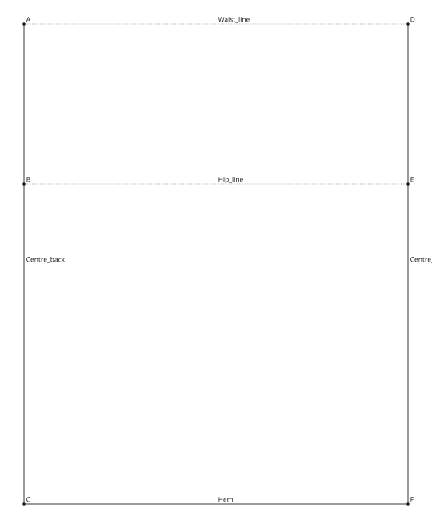
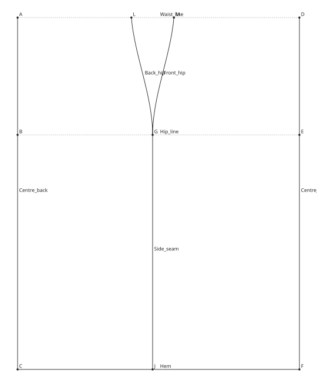
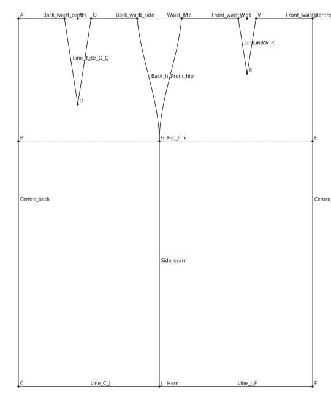
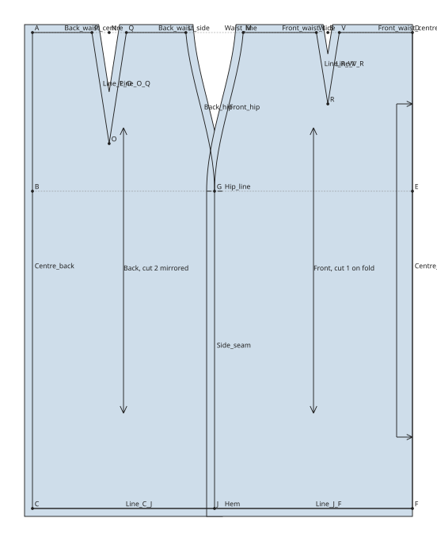

# A straight skirt block

This tutorial drafts a straight skirt block from four measurements: half the
back and half the front, each with a dart, made into two pieces ready to print.
On the way it covers points, lines and curves placed by formula, variables,
splitting an edge, and pieces.

The finished pattern is in the documentation's examples:
[skirt-block.sloper](../examples/skirt-block/skirt-block.sloper), with its
measurements in [skirt.slm](../examples/skirt-block/skirt.slm). Open it at any
point to compare.

!!! note "Units"

    This tutorial works in millimetres. Before you start, set Edit →
    Preferences → Unit to Millimetres, so the new pattern is in mm.

## 1. Measurements and variables

Save [skirt.slm](../examples/skirt-block/skirt.slm) in a folder of its own. It
holds four measurements:

| Key | Value | What it is |
| --- | --- | --- |
| `waist` | 660 | Waist circumference |
| `hip` | 920 | Hip circumference at the fullest part |
| `waist_to_hip` | 200 | Waist to hip line, at the side |
| `skirt_length` | 600 | Waist to hem, at the side |

In opensloper-design, start a new pattern (File → New), choose the measurement
file (File → Measurements…) and save the pattern beside it as
`skirt-block.sloper`.

The block is worked out from a few values that several points share. Make each
as a variable: in the Variables tab click Add, then give it its name and
formula in the Properties tab.

| Name | Formula | What it is |
| --- | --- | --- |
| `hip_ease` | `40` | Ease added round the hip |
| `waist_ease` | `10` | Ease added round the waist |
| `half_hip` | `@hip / 2 + #hip_ease / 2` | Half the hip, with its ease: the width of the block |
| `back_hip` | `#half_hip / 2 - 10` | The back's width at the hip; the side seam sits 10 mm towards the back |
| `front_hip` | `#half_hip - #back_hip` | The front's width at the hip |
| `suppression` | `(@hip + #hip_ease - @waist - #waist_ease) / 2` | How much the half skirt narrows from hip to waist |
| `side_take` | `#suppression / 4` | Taken in at the side seam, on each piece |
| `back_dart` | `#suppression * 0.3` | Width of the back dart |
| `front_dart` | `#suppression * 0.2` | Width of the front dart |

The suppression is shared out: a quarter at each side seam, 30% in the back
dart and 20% in the front dart.

## 2. The frame

The frame is a rectangle as wide as the block and as long as the skirt, with
the waist at the top, the hip line and the hem.

1. Choose the Point tool (++p++) and click to make the first point. In the
   properties, name it **A** and set X and Y to `0`. It is the waist at centre
   back.
2. Click straight below A: the status bar says *New point … below A*. This
   makes an offset point measured from A. Name it **B** and set its Length to
   `@waist_to_hip`: it is the hip at centre back.
3. Click further below A for **C**, the hem at centre back, with Length
   `@skirt_length`.
4. Click level with A, to its right, for **D**, the waist at centre front,
   with Length `#half_hip`.

Now the lines. With the Line tool (++l++), click A then D: the clicks snap to
the points you made. Name the line **Waist_line** and set its Role to
Construction, since it is only a guide. Make points **E** right of B and **F**
right of C in the same way, each with Length `#half_hip`, then draw:

| Line | From | To | Role |
| --- | --- | --- | --- |
| Hip_line | B | E | Construction |
| Centre_back | A | C | Outline |
| Centre_front | D | F | Outline |
| Hem | C | F | Outline |

Change a measurement in the Measurements tab, or try the slider at the bottom
of it, and the frame follows.

## 3. The side seam

The side seam sits at the back's width from centre back, and goes in at the
waist by the side take.

With the Point tool, click on Hip_line, nearer B than E. This makes a point
along the edge, measured from its nearer end. Name it **G** and set its
Distance or ratio to `#back_hip`. Do the same on the Hem for **J**, also
`#back_hip` from C.

On the waist line, make **L** nearer A, with `#back_hip - #side_take`, and
**M** nearer D, with `#front_hip - #side_take`. M is measured from D, the end
it is nearer, so the front is measured from centre front.

With the Curve tool (++c++), draw **Back_hip** from L to G and **Front_hip**
from M to G. Select each and set its handles, so the seam curves out over the
hip and runs straight down below it:

| Curve | Start angle | Start handle | End angle | End handle |
| --- | --- | --- | --- | --- |
| Back_hip | `275` | `@waist_to_hip / 3` | `90` | `@waist_to_hip / 3` |
| Front_hip | `265` | `@waist_to_hip / 3` | `90` | `@waist_to_hip / 3` |

Angles point the way the handle goes: 270 is straight down, and the end angle
points back along the curve, so 90 is straight up. Finally draw the line
**Side_seam** from G to J.

The hem is still one edge, and a piece is made of whole edges, so split it
where the side seam meets it: select the Hem and J, then Tools → Edge → Split
Edge. The Hem is now two parts, Line_C_J and Line_J_F.

## 4. The darts and the waist

Each dart is centred on its half of the waist, with its two sides half the
dart's width either side of the centre. All six points are on the waist line,
measured from centre back (A) for the back dart and centre front (D) for the
front.

| Point | Distance or ratio | Measured from |
| --- | --- | --- |
| N, the back dart's centre | `(#back_hip - #side_take) / 2` | A |
| P | `(#back_hip - #side_take - #back_dart) / 2` | A |
| Q | `(#back_hip - #side_take + #back_dart) / 2` | A |
| S, the front dart's centre | `(#front_hip - #side_take) / 2` | D |
| V | `(#front_hip - #side_take - #front_dart) / 2` | D |
| W | `(#front_hip - #side_take + #front_dart) / 2` | D |

Click a little away from points already there, or the click reuses them, and
then type the distance.

The dart points are below the centres: **O** straight below N, Length `140`,
and **R** straight below S, Length `90`. Draw the dart's sides as outlines,
P to O and O to Q at the back, V to R and R to W at the front, then the waist
between the darts:

| Line | From | To |
| --- | --- | --- |
| Back_waist_centre | A | P |
| Back_waist_side | Q | L |
| Front_waist_side | M | W |
| Front_waist_centre | V | D |

## 5. Pieces

Choose the Piece tool (++k++) and click inside the back, then inside the
front. Each piece is made from the outlines around the click; the construction
lines are left out. Name them **Back** and **Front** in the properties.

- The back is cut twice, as a left and a right: select Back and set Cut to `2`
  and tick Mirrored.
- The front is cut once on the fold at centre front: select Front and choose
  Centre_front under Fold. Its allowance there drops to nothing and the label
  reads *Front, cut 1 on fold*.
- Mark the hip on the side seam: choose the Notch tool (++t++) and click on G
  where it meets Side_seam. The notch goes on both pieces, so they match when
  sewn.

Both pieces start with a 10 mm seam allowance and a grainline straight down.

## What next

- Change the measurements, or the ease, and watch the whole block follow.
- Open File → Publish… to lay the pieces out and print them.
- Read [Measurements and formulas](../design/formulas.md) and
  [Pieces](../design/pieces.md) for more on each step.
